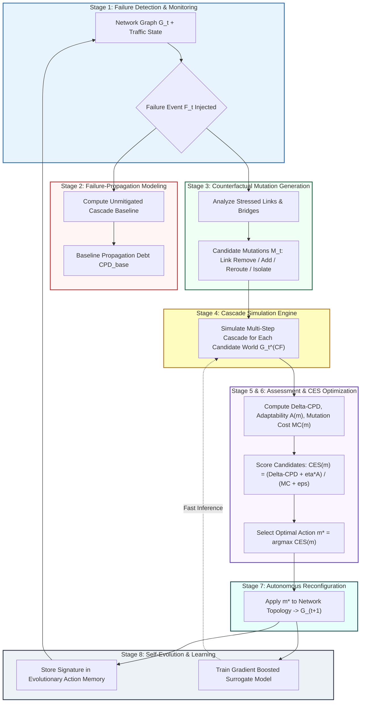
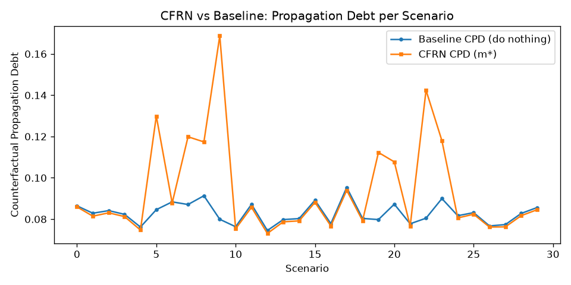
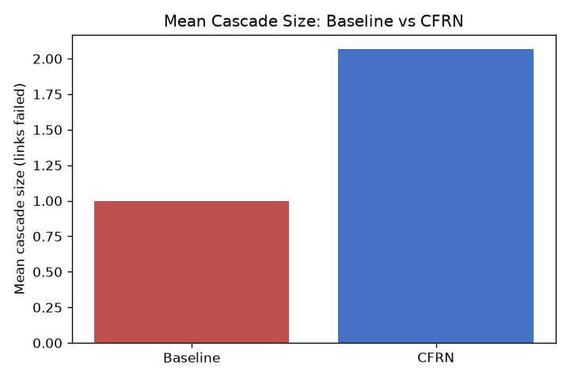
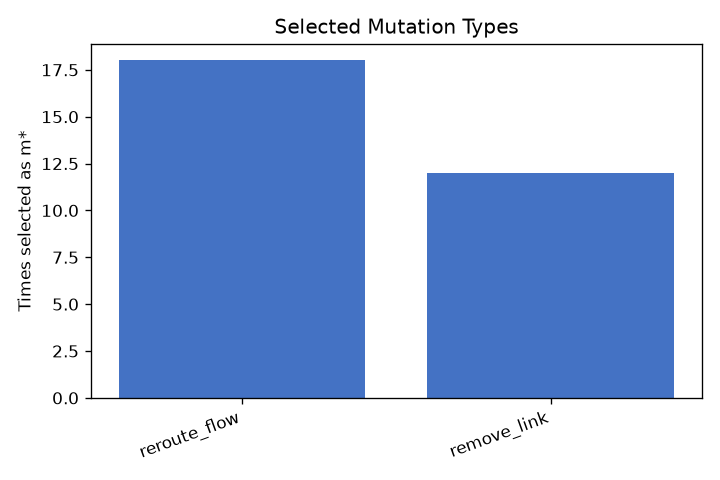

# CFRN: Counterfactual Failure-Propagation Debt Optimization for Self-Evolving Network Reconfiguration

[](https://www.python.org/)
[](LICENSE)
[-orange.svg)](CFRN_Paper.pdf)
[](CFRN/dashboard/app.py)
[](CFRN/tests/)

> **Research Paper & Implementation**: Official repository for the research paper *"Counterfactual Failure-Propagation Debt Optimization for Self-Evolving Network Reconfiguration"* formatted for **Springer Nature** journals.

---

## 📌 Executive Summary

Modern high-speed communication backbones (IP transit networks, hyperscale cloud fabrics, ISP core rings) are acutely vulnerable to **cascading failures**. When a core router or high-centrality link fails, diverted traffic overloads alternate routes, triggering secondary failures and network-wide partitioning.

Traditional recovery strategies are myopic: they reroute traffic locally without considering the downstream **propagation debt** incurred across subsequent time steps. 

**CFRN** introduces an autonomous, anticipatory closed-loop control plane that asks the counterfactual question:
> *"If mutation $m_i$ were applied immediately following failure $F_t$, how would failure propagation unfold across future time steps relative to the do-nothing baseline?"*

By systematically exploring candidate network mutations in parallel and simulating multi-step cascades before acting, CFRN optimizes a unified **Counterfactual Propagation-Evolution Score (CES)** that balances:
1. **$\Delta \text{CPD}$**: Long-term failure propagation debt reduction.
2. **$A(m)$**: Future structural adaptability (measured via algebraic connectivity / Fiedler eigenvalue $\lambda_2$).
3. **$\text{MC}(m)$**: Multidimensional operational and reconfiguration cost.

---

## 🔄 The 8-Stage Closed-Loop Architecture

CFRN operates as a continuous self-evolving feedback loop:



---

## 📐 Mathematical Formulation

### 1. Step-Level Failure-Propagation Debt ($D_{\text{FP}}$)
At any cascade step $\tau$, the network state severity is quantified as:
$$D_{\text{FP}}(G_\tau) = w_{\text{over}} \cdot \Phi_{\text{cong}}(G_\tau) + w_{\text{disc}} \cdot \Psi_{\text{disc}}(G_\tau) + w_{\text{lost}} \cdot \Omega_{\text{lost}}(G_\tau)$$

Where:
* **Congestion Pressure $\Phi_{\text{cong}}$**: Penalizes links operating beyond the headroom threshold ($\kappa = 0.75 \theta_{\text{over}}$) with super-linear penalties for hard overloads.
* **Disconnected Fraction $\Psi_{\text{disc}}$**: Ratio of nodes severed from the giant connected component $\frac{|V| - |V_{\text{giant}}|}{|V|}$.
* **Unserved Load Fraction $\Omega_{\text{lost}}$**: Proportion of total origin-destination traffic demand that cannot be routed due to partitioning.

### 2. Counterfactual Propagation Debt ($\text{CPD}$)
Accumulates time-discounted future step debt over a multi-step evaluation horizon $H$ with discount factor $\gamma \in (0, 1]$:
$$\text{CPD}(G) = \sum_{\tau=1}^H \gamma^{\tau - 1} \cdot D_{\text{FP}}(G_\tau)$$

### 3. Future Adaptability Gain ($A(m)$)
Evaluates whether a candidate mutation preserves the network's structural robustness against subsequent partitioning using the **algebraic connectivity** (Fiedler eigenvalue $\lambda_2$ of the graph Laplacian):
$$A(m) = \lambda_2\left(L(G_{\text{giant}}^{\text{CF}})\right)$$

### 4. Counterfactual Propagation-Evolution Score ($\text{CES}$)
Selects the optimal candidate mutation $m^*$ maximizing debt reduction and structural adaptability relative to reconfiguration cost:
$$\text{CES}(m) = \frac{\Delta \text{CPD}(m) + \eta \cdot A(m)}{\alpha L(m) + \beta S(m) + \chi E(m) + \epsilon}$$
$$m^* = \arg\max_{m \in \mathcal{M}} \text{CES}(m)$$

---

## 🛠️ Counterfactual Mutation Classes

| Mutation Class | Operational Mechanism | Strategic Role |
| :--- | :--- | :--- |
| `remove_link` | Deliberately deactivates vulnerable, near-overload links | Deflects traffic surges away from fragile transit hubs |
| `add_link` | Proactively activates redundant links between non-adjacent hubs | Establishes high-capacity bypass routes |
| `reroute_flow` | Shifts a fraction of load off stressed links onto shortest alternates | Dampens localized link utilization peaks |
| `isolate_path` | Cuts strategic articulation bridges adjacent to failure zones | Contains cascading failure spread to localized subnetworks |

---

## 📊 Empirical Results & Visualizations

The experiment runner simulates multi-step cascades across realistic topologies and traffic demands. The following visualizations are generated directly from the simulation pipeline:

### 1. Propagation Debt Comparison ($\text{CPD}$)
Comparison between the unrestrained "do-nothing" baseline cascade and CFRN's optimized counterfactual reconfiguration ($m^*$):
<p align="center">
  
</p>

### 2. Cascade Size Reduction
Reduction in the number of secondary link failures triggered across propagation steps:
<p align="center">
  
</p>

### 3. Frequency of Selected Mutations
Distribution of optimal counterfactual actions chosen by the CES optimizer:
<p align="center">
  
</p>

---

## 🖥️ Interactive Web Dashboard

CFRN includes a full-featured **Streamlit Web Dashboard** providing real-time interactive exploration:
* **Live Network Visualizer**: Interactive Plotly node-link graph showing intact, stressed, and failed components before and after reconfiguration.
* **Cascade Propagation Stepper**: Step-by-step breakdown of newly failed links, overloaded segments, and step debt $D_{\text{FP}}$.
* **Candidate Mutation Leaderboard**: Real-time table ranking all candidate actions by $\text{CES}$, $\Delta \text{CPD}$, adaptability, and mutation cost.
* **Batch Analytics**: Summary curves comparing baseline vs CFRN across multiple seeds.

To launch the dashboard:
```powershell
streamlit run CFRN/dashboard/app.py
```

---

## 📂 Repository Layout

```
CFRN/
├── assets/                               # Embedded result graphs for README
│   ├── cpd_comparison.png
│   ├── cascade_size.png
│   └── mutation_selection.png
├── CFRN/                                 # Core Python Project Package
│   ├── config/
│   │   └── default.yaml                  # Hyperparameters, cascade horizon, CES weights
│   ├── dashboard/
│   │   └── app.py                        # Interactive Streamlit Web UI
│   ├── data/
│   │   ├── raw/                          # CAIDA & CESNET raw data directories
│   │   └── processed/
│   ├── experiments/
│   │   └── run_experiment.py             # Multi-scenario batch simulation runner
│   ├── models/
│   │   └── cfrn_cpd_model.joblib         # Trained surrogate GradientBoosting model
│   ├── results/
│   │   └── cfrn_results.csv              # Scenario-by-scenario empirical metrics log
│   ├── src/
│   │   ├── config.py                     # Configuration loader and RNG seeding
│   │   ├── pipeline.py                   # 8-stage closed-loop orchestrator
│   │   ├── counterfactual/mutations.py   # Candidate mutation generation & application
│   │   ├── data/caida.py                 # CAIDA topology parser & scale-free generator
│   │   ├── data/cesnet.py                # CESNET traffic parser & diurnal generator
│   │   ├── data/download.py              # Dataset acquisition guide
│   │   ├── evaluation/metrics.py         # Cascade size, overload, connectivity metrics
│   │   ├── failure/injector.py           # High-betweenness node/link failure injector
│   │   ├── learning/evolve.py            # Surrogate model & evolutionary action memory
│   │   ├── network/state.py              # Shortest-path routing, capacity headroom
│   │   ├── optimization/ces.py           # Algebraic connectivity & CES scoring
│   │   └── propagation/cascade.py        # Multi-step probabilistic cascade simulator
│   ├── tests/
│   │   └── test_pipeline.py              # End-to-end and unit test suite
│   └── requirements.txt                  # Python dependencies
├── CFRN_Paper.pdf                        # Compiled 7-page academic research paper
├── CFRN_Paper.tex                        # Springer Nature (sn-jnl) LaTeX manuscript
├── CFRN_Paper.typ                        # Typst source for fast vector PDF rendering
├── sn-bibliography.bib                   # BibTeX bibliography with scholarly references
├── .gitignore                            # Excludes venv, pycache, OS junk
└── README.md                             # Comprehensive project documentation
```

---

## 🚀 Quickstart & Installation

### 1. Prerequisites
* Python 3.10, 3.11, or 3.12
* Windows, Linux, or macOS

### 2. Install Dependencies
```powershell
pip install -r CFRN/requirements.txt pytest
```

### 3. Run the Test Suite
Verify that all 8 unit and integration tests pass:
```powershell
python -m pytest --ignore=.venv -v CFRN/tests/test_pipeline.py
```

### 4. Run Batch Simulation Experiments
Execute a batch experiment over 30 closed-loop scenarios:
```powershell
python -m experiments.run_experiment --scenarios 30
```
Outputs will be logged to `CFRN/results/` (`cfrn_results.csv`, comparison charts, and serialized surrogate model).

### 5. Launch the Web Dashboard
```powershell
streamlit run CFRN/dashboard/app.py
```
Open your browser at `http://localhost:8501`.

---

## 🌐 Dataset Information

CFRN is engineered to operate on real-world datasets:
1. **CAIDA ITDK-2026-03** ([Macroscopic Internet Topology Data Kit](https://www.caida.org/catalog/datasets/internet-topology-data-kit/release-2026-03/)): Supplies realistic router-level internet topology structures.
2. **CESNET-TimeSeries24** ([CESNET Traffic Dataset Zoo](https://cesnet.github.io/cesnet-tszoo/cesnet_timeseries24/)): Supplies empirical traffic time-series distributions (diurnal/weekly seasonality and burstiness).

*Note: The pipeline includes built-in reproducible synthetic generators that mimic the exact statistical distributions of both datasets, enabling full end-to-end execution without requiring multi-gigabyte raw downloads.*

---

## 👥 Authors & Affiliation

**School of Computer Science and Engineering, VIT-AP University, Amaravati, Andhra Pradesh, India**

* **Sivaji Snehith** (Corresponding Author) — `snehith.24bcs7081@vitapstudent.ac.in`
* **Datta Sai Charan** — `charan.24bce8127@vitapstudent.ac.in`
* **Ahmed Shariff** — `sharif.24bce8418@vitapstudent.ac.in`
* **Sai Krishna** — `krishna.24bcs7094@vitapstudent.ac.in`
* **Akshay Rajkumar** — `rajkumar.24bce8597@vitapstudent.ac.in`

---

## 📖 Citation

If you use CFRN in your research, please cite our paper:

```bibtex
@article{snehith2026cfrn,
  author    = {Snehith, Sivaji and Charan, Datta Sai and Shariff, Ahmed and Krishna, Sai and Rajkumar, Akshay},
  title     = {Counterfactual Failure-Propagation Debt Optimization for Self-Evolving Network Reconfiguration},
  journal   = {Springer Nature Journal Submission},
  year      = {2026},
  publisher = {Springer Nature}
}
```

---

## 📄 License
This project is licensed under the MIT License — see the [LICENSE](LICENSE) file for details.
